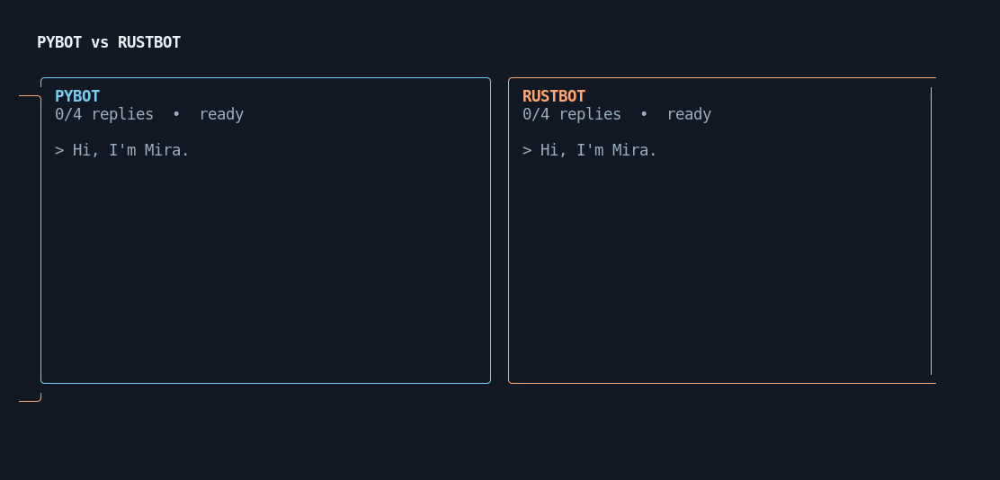

<p align="center"></p>

# RustBot

RustBot is a native Rust port of [PyBot](https://github.com/huggingface/pybot/tree/7d63c7fbebb44c7e466e5c8b5c1f341ab767929e), a rule-based chatbot. It uses regular expressions, lookup tables, and conversation memory to answer everyday questions and follow-ups. Its engine and 8,078 knowledge entries across 147 domains compile into one executable.

The port has **368,604 lines of Rust** across **931 source files**, including the generated rule tables, plus **70,417 lines** under `tests/`.

## How it was migrated

Codex used **GPT-6.2 Astra** to coordinated three **GPT-6.2 Sol subagents** working in parallel on knowledge rules and reply parity.

## Try it out



All four replies matched verbatim in this recording. PyBot finished in **7,794 ms** and RustBot finished in **548 ms**, including startup.

Build with Cargo using Rust 1.88 or newer.

```sh
git clone https://github.com/Shekswess/rustbot.git
cd rustbot
rustbot_build=$(mktemp -d /tmp/rustbot-build.XXXXXX)
cargo build --release --locked --target-dir "$rustbot_build"
"$rustbot_build/release/rustbot" --seed=0
```

A terminal conversation looks like this.

```text
user: Hi, I'm Sam.
rustbot: Nice to meet you, Sam. What can I help with?

user: How many teaspoons are in 30 ml?
rustbot: 30 ml is 6 teaspoons.

user: What's my name?
rustbot: You're Sam.
```

Type `/reset` to start a new conversation or `/exit` to quit. For a single reply or one reply per piped line, use the executable you built above.

```sh
"$rustbot_build/release/rustbot" -p "Why do onions make you cry?"
printf '%s\n' "How long should I boil an egg?" | "$rustbot_build/release/rustbot"
```

| Option | What it does |
| --- | --- |
| `-p TEXT`, `--prompt TEXT` | Reply to one message and exit. |
| `-i`, `--interactive` | With `-p`, continue chatting after the first reply. |
| `-s N`, `--seed N` | Seed the choice of wording. |
| `-v`, `--verbose` | Show the winning module and response time. |

## PyBot and RustBot comparison

The seed controls wording selection within each bot. With the same seed and conversation, PyBot and RustBot can still choose different wording or route a reply differently.

The benchmark uses a 15-prompt subset of the original 20 prompts, where 17 replies matched verbatim. The subset drops three differing prompts and a two-turn exchange whose reply changed when earlier prompts were removed. All 15 replies matched in the new preflight and all 45 matched across three fresh runs per bot. PyBot used CPython 3.14.0 and RustBot used the compact release. Both used seed 0 on an AMD Ryzen 7 9700X. Values are medians.

| Metric | PyBot | RustBot compact |
| --- | ---: | ---: |
| First reply | 2.63 s | 375 ms |
| Reply after warm-up | 453.7 ms | 30.3 ms |
| Total reply time | 12.37 s | 0.82 s |
| Peak memory (RSS) | 213.7 MiB | 166.6 MiB |

The benchmark report includes the prompt selection, per-run measurements, and the compact executable’s SHA-256. [15-prompt benchmark report](reports/benchmark.json)

## What is in this repository

| Path | What it holds |
| --- | --- |
| `src/` | 931 Rust files containing the engine, generated rules, and CLI. |
| `tests/` | 94 Rust files with integration tests and fixtures. |
| `assets/` | The banner and terminal demo. |
| `reports/` | The 15-prompt benchmark report. |

On each turn, the registered modules can propose replies. The arbiter selects the one you see. The modules use four shared parts to interpret the input, carry context forward, look up facts, and phrase the reply.

| Part | Where | Rust files | Lines |
| --- | --- | ---: | ---: |
| Understanding engine | [`src/bot/understanding/`](src/bot/understanding/) | 51 | 110,541 |
| Memory store | [`src/bot/memory/`](src/bot/memory/) | 116 | 49,481 |
| Knowledge base | [`src/bot/knowledge/`](src/bot/knowledge/) | 523 | 150,075 |
| Response composer | [`src/bot/compose/`](src/bot/compose/) | 86 | 28,323 |
| Reply modules and arbiter | [`src/bot/modules/`](src/bot/modules/) | 150 | 28,657 |
| Core and CLI | [`src/`](src/) | 5 | 1,527 |
| **Total** | [`src/`](src/) | **931** | **368,604** |

Line counts include comments, blank lines, generated Rust, and inline tests. RustBot registers 102 reply and support modules. Run the tests with `cargo test --locked --target-dir "$rustbot_build"`.

## Changes in this fork

This repository is the [C++ Alliance](https://github.com/cppalliance) fork of [Shekswess/rustbot](https://github.com/Shekswess/rustbot). The text above is the original README. The fork starts at commit `fb89123` of the original and makes one change: a caller can set the time that the bot reads.

Some replies hold a date or a time of day, such as the next full moon, an age worked out from a year of birth, or the time in another city. In the original, each of those replies reads the system clock, so the same seed and the same conversation give a different reply on another day. In this fork a caller gives the bot a fixed time, and those replies stay the same.

```rust
let mut bot = rustbot::Bot::new(Some("0"))?;
bot.set_now(Some("2026-11-22T00:00:00+00:00[UTC]"))?;
let reply = bot.turn("When is the next full moon?").reply;
```

- `Bot::set_now` takes a date, a time of day and a time zone. Each later turn of that bot reads this time, and `None` puts the system clock back. A bot that was given no time reads the system clock, as in the original.
- The command line has the same setting: `rustbot --now "2026-11-22T00:00:00+00:00[UTC]" -p "When is the next full moon?"`.
- Two bots in one process can hold different times, and every rule in one turn sees the same time.

`src/bot/clock.rs` holds the time of a running turn. The 14 places that read the system clock now read `Reading::now`, and each changed file says so in its first line.

## License

Apache License 2.0. See [LICENSE](LICENSE).
